# FacultyOS — Relational Database Architecture & Entity-Relationship (ER) Diagram

**Project:** FacultyOS — Faculty Self-Appraisal & Career Advancement Portal  
**Framework:** Django 5.1 / 6.1  
**Database Engine:** SQLite 3  
**Architecture:** 2-App Relational Schema (`core` & `appraisal`)  
**Standard Compliance:** UGC Career Advancement Scheme (CAS) & Performance Based Appraisal System (PBAS)  

---

## 1. Visual Entity-Relationship Diagram (Mermaid)

```mermaid
erDiagram
    auth_user ||--|| appraisal_facultyprofile : "has (OneToOne, CASCADE)"
    auth_user ||--o{ appraisal_appraisalsubmission : "reviews (1:N, SET_NULL)"
    appraisal_facultyprofile ||--o{ appraisal_teachingrecord : "logs (1:N, CASCADE)"
    appraisal_facultyprofile ||--o{ appraisal_researchpublication : "publishes (1:N, CASCADE)"
    appraisal_facultyprofile ||--o{ appraisal_workshoptraining : "attends (1:N, CASCADE)"
    appraisal_facultyprofile ||--o{ appraisal_completedproject : "leads (1:N, CASCADE)"
    appraisal_facultyprofile ||--o{ appraisal_appraisalsubmission : "submits (1:N, CASCADE)"

    auth_user {
        int id PK "Primary Key"
        varchar username UK "Unique login handle / ID"
        varchar email "Academic institutional email"
        varchar password "PBKDF2 SHA-256 hashed password"
        varchar first_name "Faculty / Officer given name"
        varchar last_name "Faculty / Officer surname"
        boolean is_staff "Admin / Reviewer clearance"
        boolean is_superuser "Super-administrative access"
        boolean is_active "Account status flag"
        datetime date_joined "Account creation timestamp"
    }

    appraisal_facultyprofile {
        bigint id PK "Primary Key (AutoField)"
        int user_id FK,UK "One-to-One -> auth_user.id (CASCADE)"
        varchar employee_id UK "Official institutional ID (e.g. FAC-CSE-001)"
        varchar department "Academic Department (CSE, IT, ECE, etc.)"
        varchar designation "Academic Rank (Assistant / Associate Professor)"
        varchar highest_qualification "Highest degree (Ph.D., M.Tech, etc.)"
        varchar specialization "Academic expertise / Research area"
        date date_of_joining "Institutional employment start date"
        decimal experience_years "Total academic experience (years)"
        varchar contact_number "Institutional contact phone"
        text address "Departmental / Postal address"
        varchar promotion_status "CAS promotion stage (Under Review, Eligible, etc.)"
        date promotion_eligible_date "Date candidate met promotion eligibility"
        datetime created_at "Record creation timestamp"
        datetime updated_at "Record last update timestamp"
    }

    appraisal_teachingrecord {
        bigint id PK "Primary Key (AutoField)"
        bigint faculty_id FK "Foreign Key -> FacultyProfile.id (CASCADE)"
        varchar academic_year "Academic Session (e.g. 2025-2026)"
        varchar semester "Session Semester (Odd / Even)"
        varchar subject_name "Curricular Course Title"
        varchar subject_code "Course Code (e.g. CS-401)"
        varchar course_type "Delivery Mode (Theory / Practical / Project)"
        int scheduled_hours "Prescribed curricular lecture hours"
        int conducted_hours "Actual classes conducted by faculty"
        decimal pass_percentage "Student pass rate (0.0 - 100.0%)"
        decimal student_feedback_score "Student rating metric (0.00 - 5.00)"
        text innovative_teaching_methods "ICT tools, pedagogical methods"
        datetime created_at "Timestamp"
        datetime updated_at "Timestamp"
    }

    appraisal_researchpublication {
        bigint id PK "Primary Key (AutoField)"
        bigint faculty_id FK "Foreign Key -> FacultyProfile.id (CASCADE)"
        varchar academic_year "Academic Session (e.g. 2025-2026)"
        varchar title "Paper or Publication Title"
        varchar journal_conference_name "Journal / Conference venue name"
        varchar publication_type "Indexing tier (SCI_SCOPUS, UGC_CARE, etc.)"
        varchar issn_isbn "ISSN / ISBN identifier"
        date publication_date "Formal date of publication"
        varchar indexing_details "Indexing / Impact factor details"
        varchar author_role "Author tier (First Author, Corresponding, Co-Author)"
        varchar doi_or_url "DOI or public repository link"
        datetime created_at "Timestamp"
        datetime updated_at "Timestamp"
    }

    appraisal_workshoptraining {
        bigint id PK "Primary Key (AutoField)"
        bigint faculty_id FK "Foreign Key -> FacultyProfile.id (CASCADE)"
        varchar academic_year "Academic Session (e.g. 2025-2026)"
        varchar title "Program / Workshop / FDP Title"
        varchar program_type "Training type (FDP, STTP, Workshop, etc.)"
        varchar role "Role (Participant, Resource Person, Coordinator)"
        varchar organizing_institution "Host university / AICTE / IIT / NIT"
        date start_date "Program start date"
        date end_date "Program conclusion date"
        int duration_days "Total training duration (days)"
        varchar certificate_link "Verification URL / Drive link"
        datetime created_at "Timestamp"
        datetime updated_at "Timestamp"
    }

    appraisal_completedproject {
        bigint id PK "Primary Key (AutoField)"
        bigint faculty_id FK "Foreign Key -> FacultyProfile.id (CASCADE)"
        varchar academic_year "Academic Session (e.g. 2025-2026)"
        varchar title "Project / Consultancy Title"
        varchar funding_agency "Sponsor agency (DST, AICTE, Industry, etc.)"
        varchar project_type "Type (Research Grant, Consultancy, MODROBS)"
        decimal grant_amount "Sanctioned funding amount (INR)"
        int duration_months "Project execution timeline (months)"
        varchar role "Investigator role (PI, Co-PI, Lead)"
        varchar status "Project milestone (Completed, Ongoing)"
        date completion_date "Formal closure date"
        text outcomes_summary "Patents, prototypes, publications, lab upgrades"
        datetime created_at "Timestamp"
        datetime updated_at "Timestamp"
    }

    appraisal_appraisalsubmission {
        bigint id PK "Primary Key (AutoField)"
        bigint faculty_id FK "Foreign Key -> FacultyProfile.id (CASCADE)"
        varchar academic_year "Academic Evaluation Session (e.g. 2025-2026)"
        varchar status "Workflow State (DRAFT, SUBMITTED, APPROVED, etc.)"
        decimal teaching_score "Category I Score (Weight: 40 points)"
        decimal research_score "Category II Score (Weight: 30 points)"
        decimal workshop_score "Category III Score (Weight: 15 points)"
        decimal project_score "Category IV Score (Weight: 15 points)"
        decimal total_score "Cumulative PBAS Score (Max: 100 points)"
        varchar performance_grade "Grade (Outstanding A+, Very Good A, Good B, etc.)"
        text faculty_remarks "Self-reflection & annual statement"
        text admin_remarks "Evaluation committee official findings"
        varchar promotion_recommendation "CAS Recommendation (Recommended, Deferred, etc.)"
        int reviewed_by_id FK "Foreign Key -> auth_user.id (SET_NULL, optional)"
        datetime reviewed_at "Committee review timestamp"
        datetime submission_date "Submission timestamp"
        datetime updated_at "Timestamp"
    }
```

---

## 2. Relational Schema & Cardinality Specifications

| Relationship | Type | Parent Entity | Child Entity | Key Constraint | On Delete Action | Business Logic & Justification |
| :--- | :---: | :--- | :--- | :--- | :--- | :--- |
| **User &rarr; Profile** | **1 : 1** | `auth_user` | `appraisal_facultyprofile` | `user_id` (Unique) | `CASCADE` | Every faculty member possesses exactly one institutional dossier. Deleting user profile purges academic record. |
| **Profile &rarr; Teaching** | **1 : N** | `appraisal_facultyprofile` | `appraisal_teachingrecord` | `faculty_id` | `CASCADE` | A faculty member logs multiple teaching assignments across semesters and academic sessions. |
| **Profile &rarr; Research** | **1 : N** | `appraisal_facultyprofile` | `appraisal_researchpublication` | `faculty_id` | `CASCADE` | A faculty member records peer-reviewed papers, patents, and conference presentations. |
| **Profile &rarr; Workshops** | **1 : N** | `appraisal_facultyprofile` | `appraisal_workshoptraining` | `faculty_id` | `CASCADE` | A faculty member attends FDPs, STTPs, and seminars for professional enhancement. |
| **Profile &rarr; Projects** | **1 : N** | `appraisal_facultyprofile` | `appraisal_completedproject` | `faculty_id` | `CASCADE` | Tracks sponsored grants, industry consultancy, and modernization schemes. |
| **Profile &rarr; Appraisal** | **1 : N** | `appraisal_facultyprofile` | `appraisal_appraisalsubmission` | `faculty_id` | `CASCADE` | Tracks annual appraisal submissions across academic years. Enforced unique per `(faculty_id, academic_year)`. |
| **User &rarr; Reviewer** | **1 : N** | `auth_user` | `appraisal_appraisalsubmission` | `reviewed_by_id` | `SET_NULL` | Links the reviewing Dean/HOD to the submitted dossier. Preserves audit trail even if admin user is deactivated. |

---

## 3. Database Constraints & Data Integrity

1. **Unique Employee ID:** `FacultyProfile.employee_id` enforces `unique=True` across the entire institution.
2. **Unique Annual Submission:** `AppraisalSubmission.Meta.unique_together = ('faculty', 'academic_year')` guarantees that a faculty member can submit at most one appraisal per academic session.
3. **Validating Ranges:**
   - `TeachingRecord.pass_percentage`: `0.00` to `100.00%` (enforced via `MinValueValidator` and `MaxValueValidator`).
   - `TeachingRecord.student_feedback_score`: `0.00` to `5.00` (enforced via validators).
   - PBAS scores bounded to statutory UGC weights (Teaching: 40, Research: 30, Workshops: 15, Projects: 15, Total: 100).
4. **Referential Integrity:** Enforced via SQLite foreign key pragma (`PRAGMA foreign_keys = ON`), verified with zero orphaned records.

